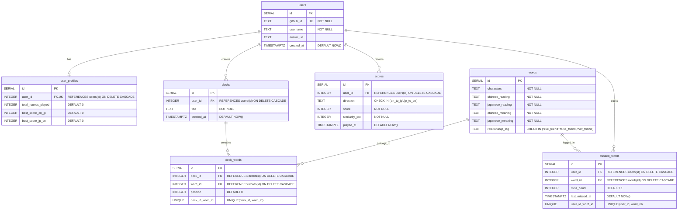

# ARCHITECTURE.md — Tandem System Architecture

## Overview
Tandem is a fullstack web application built using standard Web103 capstone architecture: a React frontend (`client/`), an Express/Node.js REST backend (`server/`), and a PostgreSQL database.

---

## 1. Database Entity-Relationship Diagram (ERD)

The system relies on 7 PostgreSQL tables with exact foreign key relationships, unique constraints, and check constraints as specified in the schema requirements.



---

## 2. Component Diagram

```mermaid
graph TD
    subgraph Client [React Frontend - client/src]
        HomePage[HomePage.jsx]
        QuizPage[QuizPage.jsx]
        SummaryPage[SummaryPage.jsx]
        ProfilePage[ProfilePage.jsx]
        DeckDashboard[DeckDashboard.jsx]
        LeaderboardPage[LeaderboardPage.jsx]
        ApiService[services/api.js]

        HomePage --> ApiService
        QuizPage --> ApiService
        SummaryPage --> ApiService
        ProfilePage --> ApiService
        DeckDashboard --> ApiService
        LeaderboardPage --> ApiService
    end

    subgraph Server [Express Backend - server/]
        AuthRoutes[/auth -> routes/auth.js]
        WordRoutes[/api/words -> routes/words.js]
        DeckRoutes[/api/decks -> routes/decks.js]
        ScoreRoutes[/api/scores -> routes/scores.js]
        ProfileRoutes[/api/profile -> routes/profile.js]
        MissedWordRoutes[/api/missed-words -> routes/missedWords.js]
        LeaderboardRoutes[/api/leaderboards -> routes/leaderboard.js]
    end

    subgraph Database [PostgreSQL Database]
        UsersTable[(users)]
        UserProfilesTable[(user_profiles)]
        WordsTable[(words)]
        DecksTable[(decks)]
        DeckWordsTable[(deck_words)]
        MissedWordsTable[(missed_words)]
        ScoresTable[(scores)]
    end

    ApiService -->|HTTP REST| AuthRoutes
    ApiService -->|HTTP REST| WordRoutes
    ApiService -->|HTTP REST| DeckRoutes
    ApiService -->|HTTP REST| ScoreRoutes
    ApiService -->|HTTP REST| ProfileRoutes
    ApiService -->|HTTP REST| MissedWordRoutes
    ApiService -->|HTTP REST| LeaderboardRoutes

    AuthRoutes --> UsersTable
    AuthRoutes --> UserProfilesTable
    WordRoutes --> WordsTable
    DeckRoutes --> DecksTable
    DeckRoutes --> DeckWordsTable
    ScoreRoutes --> ScoresTable
    ScoreRoutes --> UserProfilesTable
    ProfileRoutes --> UserProfilesTable
    ProfileRoutes --> MissedWordsTable
    MissedWordRoutes --> MissedWordsTable
    LeaderboardRoutes --> ScoresTable
    LeaderboardRoutes --> UsersTable
```

---

## 3. Architecture Decision Records (ADR)

### ADR-0001: Use Passport.js GitHub OAuth Strategy for User Authentication

- **Context:** Tandem requires authenticated user capabilities (saving custom decks, tracking missed words, recording high scores on direction leaderboards, and maintaining personal user profiles). We need a secure, standardized authentication solution that integrates cleanly with Express and PostgreSQL without storing raw passwords or requiring complex password-reset infrastructure.
- **Decision:** We decide to use Passport.js with `passport-github2` OAuth 2.0 strategy for user authentication.
- **Why:**
  1. **User Experience:** Provides 1-click authentication using existing GitHub credentials.
  2. **Security:** Offloads password storage and credential validation entirely to GitHub, eliminating password storage liabilities in PostgreSQL.
  3. **Seamless Integration:** Standardizes session serialization/deserialization into Express `req.user` and allows straightforward linking to the `users` database table using `github_id`.
  4. **PostgreSQL Match:** On successful OAuth verification, the application queries `users` by `github_id` and upserts a user row along with an initialized row in `user_profiles`.
- **Consequences:**
  - Express server requires session middleware (`express-session`) and cookie configuration.
  - Requires `GITHUB_CLIENT_ID` and `GITHUB_CLIENT_SECRET` environment variables.
  - Guest users are allowed to play quiz rounds locally, but API endpoints requiring persistence check for `req.isAuthenticated()`.
