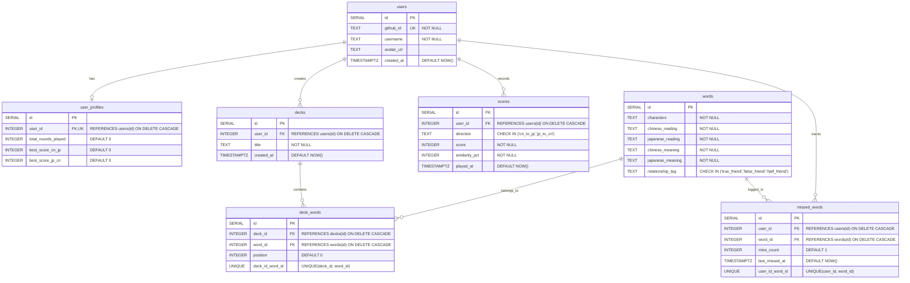

# Entity Relationship Diagram

Tandem relies on a 7-table PostgreSQL database schema tracking users, profiles, words, decks, join relationships, missed word logs, and directional high scores.

## Database Tables List

1. `users`: Stores user identity and GitHub OAuth credentials.
2. `user_profiles`: Stores 1-to-1 aggregate stats for each user.
3. `words`: Stores target character, readings, meanings, and relationship tags (`true_friend`, `false_friend`, `half_friend`).
4. `decks`: User-created or default word collections.
5. `deck_words`: Join table connecting `decks` and `words` with a unique constraint.
6. `missed_words`: Tracks mistake counts for words per user with a unique constraint.
7. `scores`: Records user quiz round performance and direction metrics.

---

## Entity Relationship Diagram (Mermaid)

